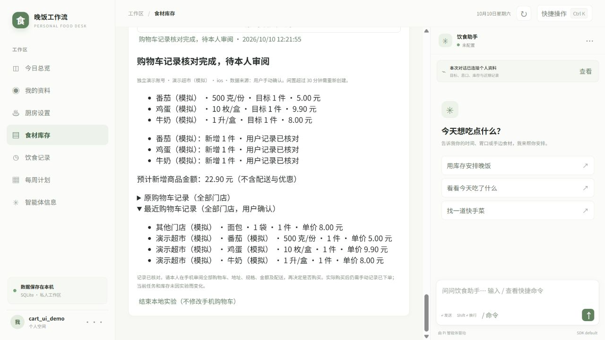

# 淘宝闪购手机选购实验

第三阶段实验分支：`codex/shopping-cart-experiment`。目标为搜索三类食材、核对规格并准备购物车，停止在本人审阅的位置。

当前状态：已实现本地实验记录和购物车差异检查，模式为 `phone_assisted`，证据来源为 `user_confirmed`。当前环境没有已连接的手机控制通道，搜索、规格查看与加购由用户在手机完成。本功能不应描述为手机自动搜索或自动加购已实现，也没有真实 App 验收结论。

## 使用流程

1. 进入库存页，创建淘宝闪购采购任务，选择任务后查看「手机选购实验」。选择 1–3 个待买条目，填写真实手机系统、账号代号、目标门店及可选的新增商品预算。不要填写手机号、账号密码或地址。
2. 在手机确认当前账号、目标门店及配送区域，完整读取购物车中所有门店已有商品。逐行填写 `门店 | 商品名称 | 完整规格 | 件数 | 单价元`，未知价格填 `?`。只有确认购物车为空时才提交空白；没有读取不等于空车。
3. 手机搜索三类食材，例如蔬菜、蛋类、乳品；以实际需求为准。逐一核对完整名称、规格、鲜冻状态、包装、件数、库存和配送可用性，在本页记录选择。名称相似不能自动推断为同规格商品。
4. 填写购物车的目标总件数。比如需求为两份且购物车已有一份，本轮只补一份；已有足量不再加购。两个需求不能重复映射到同门店同名称同规格，需先整理需求。预算只针对新增商品，不含配送费、起送门槛或优惠。
5. 生成步骤后，每次只执行一项。先完整核对当前手机购物车仍与最近记录一致，再点「先登记本步骤，再在手机加购」。该按钮只登记本地步骤，没有操作 App。
6. 本人在手机加入计划的新增件数，读取完整实际购物车并提交差异核对。新增件数不符、其他商品增减、价格变化或未知均停止后续步骤。结果不明时登记「停止并核对」，不要再点击加购；仅通过实际购物车核对才能继续。
7. 所有步骤核对完成后，停在手机购物车，审阅全部商品、规格、数量、地址、金额和配送。是否结算由本人决定。本地实验不会标记已下单或将未收到的商品入库。

闲置超过 30 分钟、采购任务改动、账号或门店变化均需要停止并重新核对。取消只结束本地实验，不撤销手机已加入的商品，也不清空购物车。发现异常后先本人核对手机，再取消旧实验并以新的真实基线创建下一轮。

## 本地一致性约束

- SQLite v16 保存 `shopping_cart_experiments`，按用户和任务隔离，带实验版本与原任务版本。记录、导出、删除和备份清理遵循现有数据生命周期。
- 每次加购先持久化待核对步骤，步骤有独立 ID；HTTP 同一操作 ID 重试只重放原结果。已登记或结果未知的步骤不能重复登记。
- 原购物车只读保存。差异按门店、完整商品名称、规格匹配；这是用户核对记录的匹配键，并非平台提供的稳定 SKU ID。真实自动化适配必须获得足够的 SKU 身份证据后重新评估。
- 同名同规格重复行拒绝，件数限定 1–100 的整数，金额用整数分；不换算盒、份、把等规格，不推测库存或可配送性。
- 不保存账号密码、验证码、收货地址或手机完整屏幕图片，不读取非购物相关手机数据。

接口：`GET /api/shopping/cart-experiments`、`GET /api/shopping/cart-experiments/:id`、`POST /api/shopping/cart-experiments`；动作路径为 `baseline`、`select`、`prepare`、`begin-step`、`unknown`、`reconcile`、`cancel`。所有动作受本机来源、用户身份、实验版本及 HTTP 操作 ID 保护。

## 真实手机验收表（尚未执行）

| 项目 | 当前状态 | 所需证据 |
|---|---|---|
| 实际平台 | 用户已选择淘宝闪购 iOS App | 实际使用版本及门店页面 |
| 已登录可操作终端 | 待确认 | 本人打开的门店 / 商品页面，必要时本人登录 |
| 三类食材搜索 | 未验证 | 实际搜索结果、规格与缺货情况 |
| 保留原购物车并准确加购 | 未验证 | 手机购物车前后完整记录和实际差异 |
| 登录稳定性和重复操作风险 | 未验证 | 会话变化、失焦/超时/重试场景记录 |
| 自动化控制与可复用适配器 | 未连接、未实现 | 获用户授权的手机控制通道及可观测界面 |
| 停在购物车审阅 | 本地流程已实现；实机待验收 | 本人审阅手机购物车，不执行支付 |

本地测试使用独立 SQLite 内存数据和模拟购物车，不把测试通过当作真实手机搜索、加购或购买成功。

## 本轮验证记录

2026-10-10：类型检查通过，28 个测试文件共 224 项测试通过，行覆盖率 87.67%；构建、构建冒烟、服务重启及操作重放检查通过。安装包检查首次缺少预期安装文件，增加缺文件诊断后复查通过，首次失败原因尚未确认。

浏览器演示使用独立内存数据库：保留其他门店原有面包，依次核对番茄、鸡蛋、牛奶三项模拟加购，最后显示完整购物车供审阅。截图为模拟数据，没有操作真实手机购物车。

门店链接指手机 App 门店页「分享 → 复制链接」得到的网址。iOS 已确认；门店链接暂未提供，可先按手动填写门店的流程验证。
